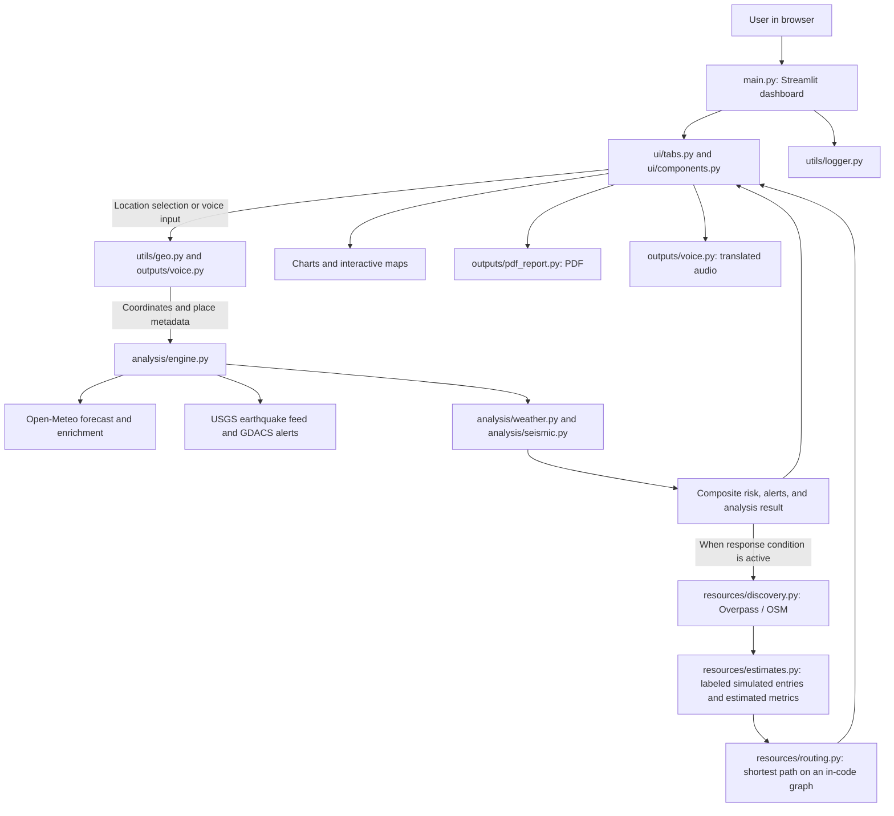

# Disaster Copilot

Disaster Copilot is a Streamlit dashboard for exploring global disaster alerts and generating a location-specific assessment of selected weather, seismic, and volcanic hazards. For an analyzed location, it presents contributing data, modeled risk levels, preparedness suggestions, nearby response resources, and downloadable report formats.

It is intended as an informational prototype for developers, students, and people exploring disaster-data workflows. It is **not an official warning system or an emergency-response authority**. Always verify conditions and instructions with local emergency services and government sources.

## Contents

- [Features](#features)
- [Technology and data sources](#technology-and-data-sources)
- [Architecture and workflow](#architecture-and-workflow)
- [Repository layout](#repository-layout)
- [Prerequisites](#prerequisites)
- [Installation](#installation)
- [Configuration](#configuration)
- [Run the application](#run-the-application)
- [How to use the dashboard](#how-to-use-the-dashboard)
- [Data, models, and limitations](#data-models-and-limitations)
- [Testing](#testing)
- [Troubleshooting](#troubleshooting)
- [Security and privacy](#security-and-privacy)
- [Contributing](#contributing)
- [License, acknowledgements, and contact](#license-acknowledgements-and-contact)

## Features

- **Global risk views:** a map shaded using earthquake magnitudes reported in the previous 24 hours, plus GDACS flood, earthquake, and volcano alert markers and a list of global danger locations.
- **India Regional Hazard Map:** a dedicated India-focused map with a cached forecast scan of representative Indian cities/districts, calibrated red/orange/green risk circles with visible district labels, an on-map district search, elevated active GDACS alert zones, searchable place analysis, hazard probability badges, and advisory popups. Select a scanned MEDIUM/HIGH location to run its full local prediction. New India analyses are added to the session map, and repeat analyses of the same locality update its marker.
- **Local assessment:** select a continent, country, state/region, and district/locality, then resolve the selected place to coordinates and analyze it.
- **Seven hazard assessments:** flood, landslide, storm/cyclone, heatwave, drought, earthquake activity, and volcano activity. Results include a level, probability-like score, confidence value, reasons, expected window, and suggested actions.
- **Response overview:** when the emergency-response condition is met, show mapped OpenStreetMap resources where available, modeled resource entries and capacity figures, and route links.
- **Analytics:** view weather charts, a per-hazard risk profile, early-warning alerts, and a location/resource context map.
- **Reports and audio:** download a generated PDF report or request a translated MP3 briefing. Voice input can resolve a spoken location when its optional speech-recognition dependency and network services are available.
- **Cached external data:** Streamlit caches selected feed, geocoding, resource, and enrichment requests for periods defined in the source.

The code contains no trained machine-learning model, training pipeline, database, account system, or inbound HTTP API. The hazard assessments are implemented as scoring rules and Bayesian-style calculations; see [Data, models, and limitations](#data-models-and-limitations).

## Technology and data sources

### Application technologies

| Technology | Use in this project |
| --- | --- |
| Python | Application, analysis, resource processing, report generation, and tests. |
| Streamlit | Browser-based dashboard, tabs, session state, widgets, caching, and audio input. |
| pandas and pydeck | Preparing global/resource map points and rendering interactive map layers. |
| folium and streamlit-folium | Rendering the India-specific interactive map, markers, circles, and popups. |
| Matplotlib | Analytics charts and map images embedded in reports. |
| ReportLab | Creating downloadable PDF reports. |
| gTTS | Synthesizing translated briefing audio as MP3. |
| SpeechRecognition | Optional speech-to-text dependency used with Google's recognition service for spoken location input. |
| requests and Python standard library | HTTP requests, geospatial calculations, logging, and other application utilities. |
| python-dotenv | Loading optional `.env` settings from the environment. |
| pytest | Automated test suite. |

There is no dependency or lock file in the repository. Installation below names the packages imported by the application and tests, but no tested minimum versions or compatibility matrix are declared.

### External services

The application makes outbound requests directly from the Python process. Service availability, coverage, rate limits, and returned data are controlled by those providers.

| Service | Use |
| --- | --- |
| Open-Meteo | Geocoding, weather forecast, historical precipitation, elevation, and river-discharge/flood data. |
| USGS Earthquake Hazards Program | All-day earthquake GeoJSON feed; the application also derives volcano-related event candidates from earthquake place descriptions. |
| GDACS | Global flood, earthquake, and volcano alert feed. |
| OpenStreetMap Nominatim | Spoken place resolution and geocoding used by location voice input. |
| Overpass API | Nearby mapped facilities and services from OpenStreetMap. Multiple configurable endpoints can be tried. |
| CountriesNow | State and city/district lists, supplemented by in-code fallback locations. |
| World GeoJSON hosted on GitHub | Country outlines used by the global map. |
| Google Translate endpoint and MyMemory | Translation of generated audio narratives; MyMemory is the fallback when the first translation service fails. |
| Google speech recognition and Google Text-to-Speech | Recognition of spoken locations and generated speech audio. |
| Google Maps | External route links opened by the response interface; routing itself is not calculated by Google Maps in this application. |

No API credentials are configured or required by the current code. Public-service policies and usage limits still apply.

## Architecture and workflow

`main.py` creates the Streamlit page and top-level tabs. UI functions in `ui/tabs.py` handle user interaction and display reusable components from `ui/components.py`. A local analysis calls `analysis/engine.py`, which resolves the selected location, fetches weather and seismic data, runs hazard calculations, and conditionally prepares emergency-resource data. Geography helpers are in `utils/geo.py`; external resource normalization and generated estimates are in `resources/`.



The global map has a separate feed path: it loads country geometry, aggregates the latest earthquake feed by the country text in each event's place description, and overlays selected GDACS events. Live-data failures are handled differently by feature: some enrichment calls are best-effort, the Overpass resource lookup can fall back to simulated entries, and the map displays a warning if it cannot be assembled.

## Repository layout

```text
.
├── analysis/
│   ├── engine.py          # Orchestrates local analysis and combines its results
│   ├── seismic.py         # Earthquake/volcano feed handling and risk calculations
│   └── weather.py         # Weather enrichment and weather-related risk calculations
├── config/
│   ├── settings.py        # Environment overrides, data URLs, and application constants
│   ├── styles.py          # CSS used by dashboard views
│   ├── oldsettings.txt    # Legacy settings snapshot; not imported by the application
│   └── __init__.py        # Configuration exports
├── outputs/
│   ├── pdf_report.py      # PDF report and report map/chart generation
│   ├── voice.py           # Speech input, narrative, translation, and audio generation
│   └── __init__.py        # Output helpers exported by the package
├── resources/
│   ├── discovery.py       # OpenStreetMap Overpass lookup and resource normalization
│   ├── estimates.py      # Estimated capacity and simulated resource generation
│   ├── routing.py         # Dijkstra shortest-path helper
│   └── __init__.py
├── tests/
│   ├── conftest.py        # Shared test fixture
│   ├── test_analysis.py   # Hazard calculations and analysis orchestration
│   ├── test_geo.py        # Geospatial and location-resolution tests
│   ├── test_main.py       # Dashboard tab routing test
│   ├── test_outputs_ui.py # Report, voice, and UI helper tests
│   └── test_resources.py  # Resource normalization, estimates, and routing tests
├── ui/
│   ├── components.py      # Reusable risk, resource, and route display components
│   ├── india_map.py       # India-focused prediction map and session-layer helpers
│   ├── tabs.py            # Dashboard view rendering and user workflows
│   └── __init__.py
├── utils/
│   ├── geo.py             # Geocoding, map data, distance, and location directory helpers
│   ├── logger.py          # Application logging and visible error reporting
│   └── __init__.py
├── main.py                # Streamlit application entry point
├── TESTING.md             # Existing test-suite instructions
└── __init__.py
```

This tree omits Python caches and generated local output. Running the app can create `disaster_copilot.log`, `report.pdf`, `location_map.png`, `rain.png`, `temp.png`, and an audio-report MP3 in the current working directory. A local `.env` file is also supported; do not publish its contents.

## Prerequisites

- Python and `pip`. The repository does not specify a required Python version. The inspection environment used Python 3.13.9, which is not a declaration that other versions are supported.
- Internet access for geocoding, weather/seismic/disaster feeds, map/resource lookup, translation, and speech services. Some analysis inputs are best-effort, but full dashboard functionality depends on external services.
- A modern browser for the Streamlit UI. Browser audio input requires microphone access and may require permission from the user.

No database server, model download, API key, or system service is set up by the repository.

## Installation

From a fresh clone:

```powershell
git clone https://github.com/Sanjana-choudhari-305/Disaster-Copilot2.0.git
cd Disaster-Copilot2.0
python -m venv .venv
.\.venv\Scripts\Activate.ps1
python -m pip install --upgrade pip
python -m pip install streamlit requests python-dotenv pandas pydeck matplotlib reportlab gTTS SpeechRecognition pytest folium streamlit-folium
```

For macOS or Linux, activate the environment with:

```bash
source .venv/bin/activate
```

The explicit install list is provided because this repository has no `requirements.txt`, `pyproject.toml`, or lock file. `SpeechRecognition` is imported optionally so the rest of the application can load without it, but the spoken-location feature requires it. There is no separate database or model initialization step.

## Configuration

`config/settings.py` calls `load_dotenv()` and reads the following optional environment variables. Defaults are used when variables are not set; a local `.env` file is not required. URL values are endpoint overrides, not secrets.

| Variable | Default / meaning |
| --- | --- |
| `APP_NAME` | `DisasterCopilot/1.0`; included in service User-Agent values. |
| `CONTACT_EMAIL` | `disaster-copilot@example.com`; included in the general User-Agent. Consider setting a real project contact when using public services. |
| `WORLD_GEO_JSON_URL` | GitHub-hosted world country GeoJSON URL. |
| `NOMINATIM_SEARCH_URL` | Nominatim search endpoint. |
| `COUNTRIES_NOW_BASE_URL` | CountriesNow API base URL. |
| `USGS_EARTHQUAKE_URL` | USGS all-day earthquake GeoJSON feed. |
| `GDACS_FEED_URL` | GDACS GeoJSON feed URL. |
| `OPEN_METEO_GEOCODING_URL` | Open-Meteo geocoding endpoint. |
| `OPEN_METEO_FORECAST_URL` | Open-Meteo forecast endpoint. |
| `OPEN_METEO_ARCHIVE_URL` | Open-Meteo archive endpoint. |
| `OPEN_METEO_ELEVATION_URL` | Open-Meteo elevation endpoint. |
| `OPEN_METEO_FLOOD_URL` | Open-Meteo flood endpoint. |
| `OVERPASS_ENDPOINTS` | Comma-separated Overpass interpreter endpoints; three public endpoints are configured by default. |
| `OVERPASS_REQUEST_TIMEOUT_S` | Per-request timeout in seconds; default `4`. |
| `OVERPASS_TOTAL_BUDGET_S` | Overall Overpass time budget in seconds; default `5`. |
| `GOOGLE_TRANSLATE_URL` | Google translation endpoint used for generated briefings. |
| `MYMEMORY_TRANSLATE_URL` | MyMemory translation fallback endpoint. |
| `LOG_LEVEL` | Logging level; default `INFO`. |

Example optional `.env` overrides (use your own contact details):

```dotenv
APP_NAME=DisasterCopilot/1.0
CONTACT_EMAIL=maintainer@example.org
LOG_LEVEL=INFO
OVERPASS_REQUEST_TIMEOUT_S=4
OVERPASS_TOTAL_BUDGET_S=5
```

Keep `.env` local and check repository ignore rules before committing. This repository does not include a dependency manifest or documented secret-management mechanism.

## Run the application

From the repository root with the virtual environment active:

```powershell
python -m streamlit run main.py
```

Streamlit normally serves the dashboard at `http://localhost:8501`. Its startup output gives the local and network URLs. The page title is **Disaster Copilot**. Stop the process with `Ctrl+C` in the terminal running Streamlit.

## How to use the dashboard

1. Open **Global Risk**. **Danger Locations** lists supported GDACS flood, earthquake, and volcano alerts. **Live Risk Map** displays earthquake-activity shading and GDACS alert markers.
2. In **Live Risk Map**, expand **Select a place for local analysis**. Choose a continent, country, state/region, and district/locality. The state and locality lists are requested from CountriesNow, with limited in-code fallback data.
3. Optionally record the location using **Say your district, state, and country** and select a spoken language. Voice recognition and place resolution require browser microphone permission and network access.
4. Select **Analyze Risk**. A successful analysis populates the **Prediction**, **Response**, **Analytics**, and **Report** tabs. For locations within India, it also adds or updates a marker on **India Regional Hazard Map** and focuses the map on the latest analyzed point. If the place cannot be resolved, select a different locality or check the network connection.
5. On **India Regional Hazard Map**, colored points show conservative, weighted forecast evidence for representative monitored locations across India. Red requires both a scan score of at least 70 and a confirmed high hazard signal; orange requires a score of at least 40 and notable hazard evidence; otherwise the location is green. Search monitored district names in the map's search control to zoom to a labeled point and open its advisory. The scan refreshes every 30 minutes; use **Refresh India-wide risk scan** to request updated forecasts. Select a MEDIUM/HIGH result to run its full local prediction, or search for any Indian city, town, or district directly. Active GDACS alert areas are shown separately when available. Scan locations are not exhaustive district coverage, and map circles are visualization buffers, not modeled hazard footprints or official warning areas.
6. Review each hazard’s level, model probability/confidence values, reasons, expected window, and suggested actions. Use the **Why this prediction? / Recommended actions** expanders for details.
7. When response resources are shown, check each resource’s source badge. `Live Data` denotes a mapped OpenStreetMap location; `Estimated` denotes a generated entry. Capacity and operational metrics are modeled even for live-mapped facilities.
8. In **Report**, download the PDF or generate and download an audio briefing in a supported language. Translation and audio generation contact external services.

There is no inbound REST API to call. The dashboard itself is the user-facing interface.

## Data, models, and limitations

### Analysis and workflow

The local analysis resolves a selected place to coordinates, fetches current and forecast weather, and requests historical rainfall, elevation, and river-discharge information as best-effort enrichment. It reads the USGS earthquake feed and derives nearby volcano candidates from event place descriptions. Weather and seismic modules calculate hazard details. The engine combines the seven hazard scores into an overall risk score and creates alerts for medium/high hazards.

The predictor compares a threshold-based result with a Bayesian-style result for flood, earthquake, and volcano activity and selects the candidate with the higher confidence value. Other hazards use threshold/scoring rules. The composite score uses confidence-adjusted probabilities constrained by hazard level bands, then takes the maximum hazard score as the overall score. These numbers are application outputs, not independently validated probabilities or calibrated forecasts.

### Model and dataset status

- No machine-learning/deep-learning model is loaded or trained. There is no dataset preparation or model evaluation pipeline in this repository.
- The algorithms are hand-coded heuristics and Bayesian-style likelihood calculations over live feed data and forecast inputs. Their parameters and thresholds are in `analysis/weather.py`, `analysis/seismic.py`, and `analysis/engine.py`.
- The earthquake prediction describes the likelihood of continued/aftershock activity, not prediction of when a new earthquake will occur. Volcano estimates are derived from nearby seismic feed events; they are not official volcano monitoring.
- Hazard inputs may be unavailable, delayed, incomplete, or differently covered across locations. Historical rainfall, elevation, and river-discharge lookups are treated as optional enrichment.

### Emergency resources and routes

Live facility locations are normalized from Overpass/OpenStreetMap tags. If coverage is insufficient or Overpass fails, the app can add clearly marked simulated facilities to response groups. Operational details such as bed occupancy, ambulance availability, personnel, capacity, status, and travel time are estimated by `resources/estimates.py`; they are not verified live facility information, including when attached to a live-mapped location.

The safe-path display uses Dijkstra’s algorithm, but the graph passed by `analysis/engine.py` is a small, fixed abstract graph rather than a road network. The Google Maps evacuation link uses a destination offset from the analyzed coordinates, while hospital links are generated from facility coordinates and the analyzed location. These are not validated evacuation routes, do not model road closures or terrain, and must not be treated as operational routing advice.

The global country shading aggregates earthquake magnitudes based on the country name parsed from each event's place string. It is a visualization of that feed, not a comprehensive country-level disaster risk index. The separate India regional map runs existing hazard scorers against a cached batch forecast for representative monitoring cities, then applies a conservative weighted-evidence score and requires confirmed high evidence before coloring a point red. The map thresholds and weights are display heuristics, not empirically calibrated forecasts. Representative points do not cover every district, and their circles are display buffers, not forecasts of affected areas. User-run predictions are held in Streamlit session state. GDACS markers shown by the global map are restricted to flood, earthquake, and volcano events.

## Testing

The repository’s existing test instructions are in [TESTING.md](TESTING.md). With the project dependencies and pytest installed, run from the repository root:

```powershell
python -m pytest -q
```

Tests cover hazard calculations, analysis orchestration, geospatial helpers, resource parsing and estimates, routing, voice/report helpers, UI formatting, and tab routing. External responses are mocked in the tests; the suite is intended to run without network access. This README does not claim the tests pass; run the command in your environment to verify.

## Troubleshooting

| Symptom | What to check |
| --- | --- |
| `ModuleNotFoundError` on startup or during tests | Confirm the virtual environment is active and install the packages listed in [Installation](#installation). |
| Streamlit command is not found | Run `python -m streamlit run main.py` from the repository root using the environment’s Python. |
| Place lists are empty or a locality cannot be analyzed | Check internet access and the CountriesNow/Open-Meteo services. Fallback locations are limited, and geocoding can return no match. |
| Map or feed is unavailable | Check internet access and provider availability. GDACS, USGS, and the country GeoJSON are external dependencies; the UI can report an unavailable feed. |
| Response resources show an error or estimated entries | Overpass data is subject to coverage and endpoint availability. Simulated resource entries and capacity numbers are estimates, not confirmed services. |
| Voice input or audio generation fails | Check browser microphone permission, `SpeechRecognition` installation for speech input, network access, selected language support, and translation/TTS service availability. |
| PDF generation fails | Confirm the report dependencies are installed and the process can write to its current working directory. The application writes report and image artifacts there. |

## Security and privacy

- The application has no authentication or authorization layer. Do not expose an instance to an untrusted network as a production service without adding appropriate access controls and deployment security.
- Location queries, coordinates, and (when used) audio for transcription and narrative text for translation are sent to third-party services. Review provider privacy terms before use with sensitive information.
- There are no API keys in the current configuration. Do not add credentials or private values to source control; keep `.env` local and use an appropriate secret manager for deployment.
- Public HTML fragments are rendered in several views. The GDACS alert display escapes provider-supplied text; treat external data and any future user-provided content carefully when changing rendering code.
- The dashboard provides estimates and informational suggestions only. Do not use it as the sole basis for evacuation, medical, or emergency decisions.

## Proposed future enhancements

These are suggestions, not implemented features:

- Add a dependency manifest with pinned or bounded versions and declare the supported Python range.
- Calibrate and independently validate hazard models against documented datasets; publish methodology and uncertainty.
- Replace the abstract route graph and offset-based destination with a maintained routing service and verified safe-zone data.
- Integrate verified operational-capacity feeds and distinguish unknown values from estimates throughout the UI and reports.
- Add deployment authentication, privacy disclosures, service-health indicators, and configurable data-retention behavior.
- Expand automated tests for external-service failure modes and end-to-end browser workflows.

## Contributing

Contributions are welcome. A practical contribution workflow is:

1. Fork the repository and create a focused branch.
2. Make a scoped change and add or update tests where behavior changes.
3. Run `python -m pytest -q` from the repository root.
4. Open a pull request describing the change, verification performed, and any effects on external services or user-facing risk guidance.

No `CONTRIBUTING.md`, code of conduct, or issue/PR template is currently present. Please avoid including secrets, personal data, or unverified emergency guidance in contributions.

## License, acknowledgements, and contact

**License:** No license file or license declaration was found in the repository. No reuse or redistribution license is specified.

**Acknowledgements and references:** The implementation integrates Open-Meteo, USGS Earthquake Hazards Program, GDACS, OpenStreetMap services (Nominatim and Overpass), CountriesNow, a world GeoJSON file hosted on GitHub, Google speech/translation services, and MyMemory. It also uses the Python libraries listed under [Technology and data sources](#technology-and-data-sources). Review each provider’s terms, attribution, and usage requirements before deployment. No research-paper citation or source dataset for model calibration is specified in the project.

**Author and contact:** No maintainer identity or project contact details are documented in the source files. Replace this note with verified maintainer details when available. The Git remote configured for this checkout is [Sanjana-choudhari-305/Disaster-Copilot2.0](https://github.com/Sanjana-choudhari-305/Disaster-Copilot2.0).
